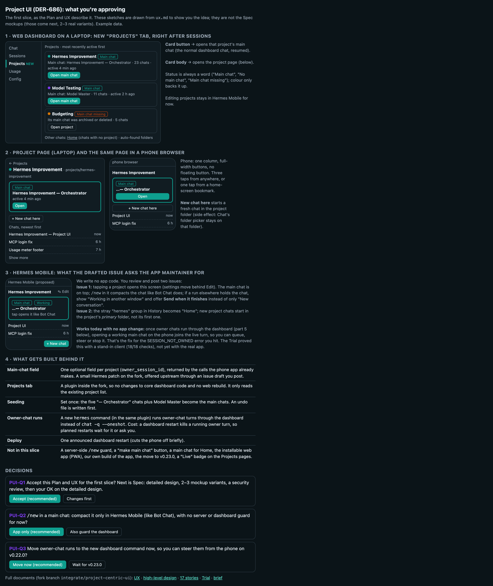

# Plan/UX gate (DER-686)

What Alex is asked to approve at the Plan/UX gate, on one page. The sketches are drawn from `../ux.md`; they are not the Spec mockups.

Source: `plan-ux-gate.html`. Full documents: [UX](../ux.md), [HLD](../hld.md), [stories](../stories/), [Trial](../poc/poc.md), [brief](../brief.md).
