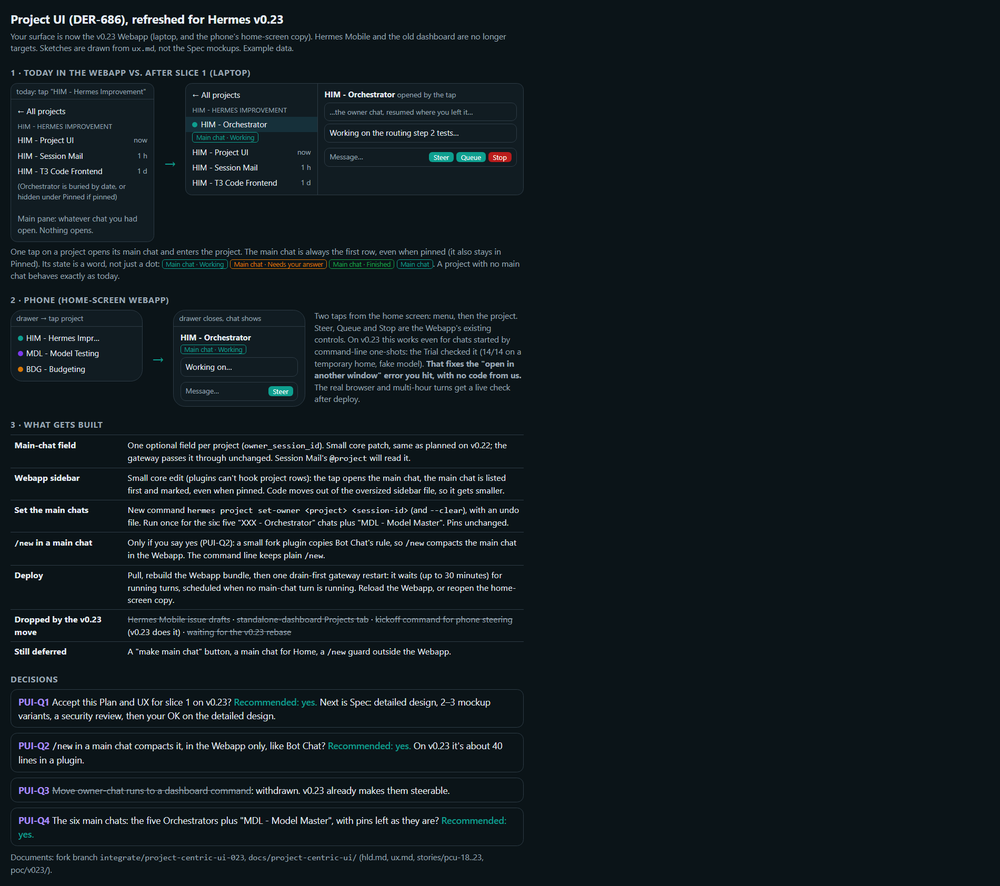

# Plan/UX gate (DER-686)

What Alex is asked to approve at the Plan/UX gate, on one page. Sketches are drawn from `../ux.md`; they are not the Spec mockups.

Current (v0.23 base, Webapp surface):

Superseded (v0.22 base, dashboard and Hermes Mobile): `plan-ux-gate.png`.

Full documents: [UX](../ux.md), [HLD](../hld.md), [stories](../stories/), [Trial on v0.23](../poc/v023/), [brief](../brief.md).
